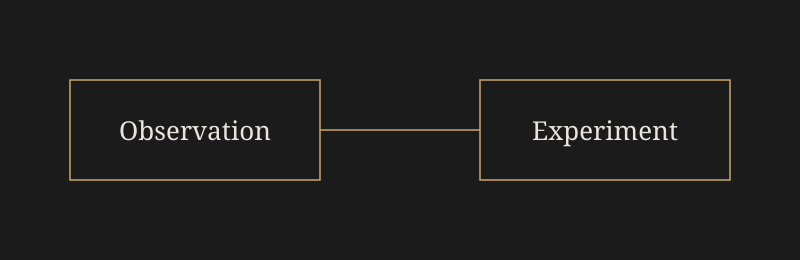

This is a draft you can copy. Open it with `npm run dev`; it does not appear in the published website.

## Text and links

Write normal paragraphs, use **bold** or *italics*, and add [a hyperlink](https://github.com/tssng). Link to another page with [research](/research/).

- A short list
- Another point

## Images

Put an image beside `index.md`. Add it anywhere in the document using Markdown. The quoted text becomes a caption; leave it out if you do not want one.



## Text boxes

> [!NOTE] A side note
>
> This box can contain **formatting**, [links](https://github.com/tssng), and multiple paragraphs.
>
> Keep a `>` at the start of each line inside the box.

> [!TIP]
> Add a short takeaway or useful detail here.

> [!WARNING] A limitation
>
> Describe a limitation in the evidence here.

## Code and quotations

```python
for checkpoint in checkpoints:
    evaluate(checkpoint)
```

> A normal blockquote works too, without an alert marker.

## Publishing

Change the title, date, and summary at the top. Set `draft: false` when you are ready, then commit and push your post folder to `main`.
